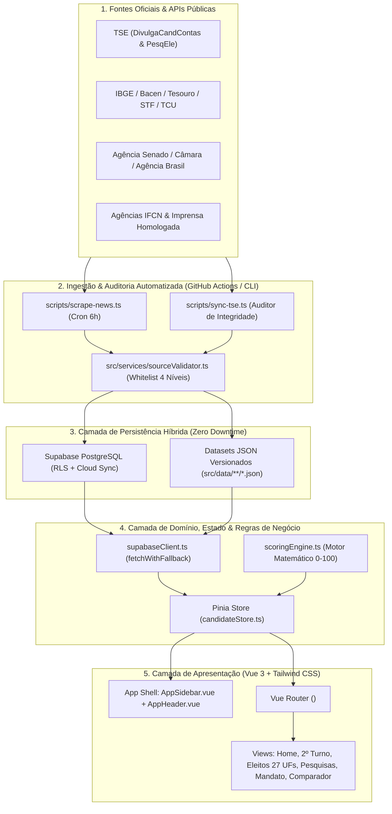

# Documentação de Arquitetura do Sistema, Arquitetura de Dados & Design Patterns: Voto Consciente

Plataforma cívica, apartidária e baseada em evidências para avaliação analítica de candidatos aos poderes Executivo e Legislativo (Federal e Estadual), acompanhamento do **2º Turno Presidencial 2026**, consulta aos **Eleitos nas 27 Unidades Federativas** e **Auditoria Contínua de Mandatos**.

---

## 1. Visão Geral da Arquitetura (Diagrama de Fluxo)



---

## 2. Departamentalização da Estrutura de Diretórios

A aplicação é dividida em departamentos arquiteturais independentes, permitindo manutenção desacoplada, auditoria determinística de fontes e escala nacional.

```text
.github/
└── workflows/
    └── update-news.yml              # Automação CI/CD (Scraping a cada 6h, Auditoria & Keep-alive Supabase)
doc/
├── ARQUITETURA.md                   # Arquitetura de Software, Arquitetura de Dados e Design Patterns
├── CHANGELOG.md                     # Histórico detalhado de versões e decisões técnicas
├── COMPLIANCE_E_AVISO_LEGAL.md      # Salvaguarda jurídica, CF/88, LAI e ADI 4451 STF
├── DIRETRIZES_IA_ATUALIDADE.md      # Protocolo mandatório de validação TSE e bloqueio de anacronismos
├── FONTES_OFICIAIS_E_METODOLOGIA.md # Catálogo de fontes oficiais, whitelists e auditoria CLI
├── MANUAL_DE_EXPANSAO_ESTADOS.md    # Guia técnico para expansão territorial (27 UFs)
└── PLANO_CRESCIMENTO_MANDATO_E_MONETIZACAO.md # Roadmap 2027-2030, proteção Open Source e monetização
scripts/
├── scrape-news.ts                   # Pipeline de ingestão multi-fonte (Google News, Senado, Câmara, EBC)
├── seed-supabase.ts                 # Sincronização e expurgo de registros legados no PostgreSQL/Supabase
├── generate-elected-data.ts         # Gerador estruturado dos 109 eleitos nas 27 UFs
├── sync-tse.ts                      # Auditor automatizado de integridade factual, links e protocolos TSE
├── test-scoring.ts                  # Suite de testes unitários do motor matemático de pontuação
├── update-polls-json.ts             # Utilitário de atualização de séries históricas do PesqEle/TSE
└── update-presidente-json.ts        # Utilitário de manutenção e higienização de dossiês presidenciais
src/
├── App.vue                          # App Shell principal (Sidebar + Header + RouterView isolado + Modais)
├── main.ts                          # Bootstrap da aplicação Vue 3, Pinia e Vue Router
├── router/
│   └── index.ts                     # Definição de rotas e scrollBehavior
├── types/                           # 1. Departamento de Modelagem & Contratos TypeScript
│   ├── candidate.ts                 #    - Contratos de Candidato, Score, Mandato e Homologação TSE
│   ├── elected.ts                   #    - Contratos de Eleitos 2026 (27 UFs) e Compromissos
│   ├── secondRound.ts               #    - Contratos de 2º Turno, Pesquisas, Rejeição e Apoios Estaduais
│   └── polling.ts                   #    - Contratos do Agregador Histórico de Pesquisas (1º e 2º Turnos)
├── services/                        # 2. Departamento de Regras de Negócio, Validação & APIs
│   ├── sourceValidator.ts           #    - Motor de Validação de Fontes Confiáveis (TSE, IFCN, Imprensa)
│   ├── scoringEngine.ts             #    - Motor matemático auditável do Score (0-100)
│   ├── supabaseClient.ts            #    - Cliente híbrido Supabase com Fallback Offline (Zero Downtime)
│   └── publicDataApis.ts            #    - Conectores com APIs abertas (TSE, IBGE, Câmara, Senado)
├── data/                            # 3. Departamento de Dados Federativos & Eleitorais
│   ├── registry.ts                  #    - Registro e indexador central de esferas e UFs
│   ├── second-round-2026.json       #    - Dados oficiais do 2º Turno, pesquisas TSE e apoios estaduais
│   ├── elected-2026.json            #    - Base nacional dos 109 eleitos nas 27 UFs e propostas
│   ├── live-news.json               #    - Feed de notícias purificado por whitelist de confiabilidade
│   ├── candidates.json              #    - Snapshot consolidado de referência
│   ├── polls/
│   │   ├── presidential-polls.json  #    - Séries históricas presidenciais (1º e 2º Turnos PesqEle/TSE)
│   │   └── sp-polls.json            #    - Séries históricas estaduais de São Paulo
│   ├── federal/
│   │   └── presidente.json          #    - Candidaturas presidenciais homologadas no DivulgaCandContas
│   └── estados/
│       └── sp/                      #    - Esfera Estadual (governador.json, senador.json, deputados.json)
├── stores/                          # 4. Departamento de Estado Reativo (Pinia)
│   └── candidateStore.ts            #    - Estado global, filtros, busca instantânea, pesos e comparador
├── components/                      # 5. Departamento de Apresentação (Design System)
│   ├── common/
│   │   └── TrustedSourcesModal.vue  #    - Central Interativa de Validação de Fontes & Auditoria TSE
│   ├── layout/
│   │   ├── AppSidebar.vue           #    - Sidebar colapsável estilo Notion/Jira com Hover Peek e Drawer Mobile
│   │   ├── AppHeader.vue            #    - Header fixo com Breadcrumbs, Busca Global (Ctrl+K) e Seletor UF
│   │   ├── Footer.vue               #    - Rodapé institucional e aviso de transparência
│   │   └── Navbar.vue               #    - Componente legado de navegação superior
│   ├── polls/
│   │   └── PollingTrackerChart.vue  #    - Gráfico de evolução temporal de pesquisas registradas no TSE
│   ├── shared/
│   │   ├── BaseModal.vue            #    - Container modal acessível com Teleport
│   │   ├── CandidateAvatar.vue      #    - Avatar resiliente com fallback automático e monograma partidário
│   │   ├── DisclaimerModal.vue      #    - Modal de aviso legal e apartidarismo
│   │   ├── EconomicTrendChart.vue   #    - Gráfico SVG multi-aba (PIB, IPCA, Desemprego, Dívida, Fiscal)
│   │   ├── FactCheckBadge.vue       #    - Selo semântico de checagem factual e status judicial
│   │   ├── PromisesProgress.vue     #    - Barra e contadores de cumprimento de promessas de campanha
│   │   ├── RadarChart.vue           #    - Gráfico de teia SVG das 5 dimensões do Score
│   │   ├── ScoreGauge.vue           #    - Medidor circular resiliente (safeScore) de pontuação 0-100
│   │   └── WeightCustomizerModal.vue#    - Customizador interativo de pesos do algoritmo
│   └── candidate/
│       ├── CandidateCard.vue        #    - Card resumo com Selo TSE, barras de critérios e botão comparar
│       ├── FactCheckTimeline.vue    #    - Linha do tempo de certidões negativas e checagens com deep links
│       ├── GovPlanViewer.vue        #    - Leitor estruturado do Plano de Governo por eixos e viabilidade
│       └── LiveNewsFeed.vue         #    - Feed filtrável de notícias verificadas por candidato
└── views/                           # 6. Departamento de Rotas & Telas Principais
    ├── HomeView.vue                 #    - Dashboard Inicial com Destaques de 2º Turno, Eleitos e Ranking
    ├── SecondRoundView.vue          #    - Módulo Especial: 2º Turno Presidencial 2026 (/segundo-turno)
    ├── ElectedCandidatesView.vue    #    - Painel Nacional: Eleitos 2026 nas 27 UFs (/eleitos)
    ├── PollsAggregatorView.vue      #    - Agregador Oficial de Pesquisas TSE 1º e 2º Turnos (/pesquisas)
    ├── CandidatesListView.vue       #    - Listagem e Filtro de Candidatos por Cargo (/presidente, /senador, etc.)
    ├── CandidateDetailView.vue      #    - Dossiê Individual Completo (/candidato/:id)
    ├── CurrentMandateView.vue       #    - Auditoria do Mandato Atual (/mandato-atual)
    └── ComparisonView.vue           #    - Comparador Lado a Lado de Candidatos (/comparador)
```

---

## 3. Design Patterns Aplicados (Padrões de Projeto)

O projeto adota padrões clássicos de Engenharia de Software para garantir testabilidade, baixo acoplamento, tolerância a falhas e auditabilidade pública:

### 3.1. Strategy Pattern & Dynamic Weighting (`src/services/scoringEngine.ts`)
- **Problema:** Diferentes eleitores atribuem importâncias distintas a critérios como Escolaridade, Experiência, Sabatinas, Integridade e Plano de Governo.
- **Solução:** O motor `scoringEngine.ts` desacopla o cálculo individual de cada dimensão (`calculateEducationScore`, `calculateExperienceScore`, `calculateDebatesScore`, `calculateIntegrityScore`, `calculateGovPlanScore`) da estratégia de ponderação (`UserWeights`). Quando o usuário ajusta os sliders em `WeightCustomizerModal.vue`, a `candidateStore` recalcula instantaneamente o `ScoreBreakdown` de todos os candidatos sem mutar os dados originais.

### 3.2. Chain of Responsibility & Specification Pattern (`src/services/sourceValidator.ts`)
- **Problema:** Garantir que nenhuma notícia de portal duvidoso, pesquisa sem registro no TSE ou candidatura especulativa entre na base.
- **Solução:** `sourceValidator.ts` implementa especificações encadeadas de validação:
  1. `validateCandidacyRole()` verifica elegibilidade e homologação para o cargo pleiteado;
  2. `validateTseRegistration()` valida a máscara regulamentar `UF-NNNNN/AAAA`;
  3. `validateSourceUrl()` classifica o domínio nos 4 níveis de autoridade;
  4. `validateNewsArticle()` aplica barreira anti-clickbait + verificação de veículo.

### 3.3. Circuit Breaker / Offline-First Fallback Pattern (`src/services/supabaseClient.ts`)
- **Problema:** Bancos em nuvem gratuitos (Supabase Free Tier) podem sofrer latência, limites de requisição ou manutenção, o que jamais pode derrubar uma plataforma cívica de alto tráfego.
- **Solução:** A função genérica `fetchWithFallback<T>(supabaseFetcher, localFallback)` tenta buscar dados atualizados no PostgreSQL remoto aplicando guardrails de validação; se houver qualquer falha de rede ou se as variáveis de ambiente não estiverem configuradas, o sistema retorna imediatamente os datasets JSON versionados no bundle local (`src/data/**/*.json`), garantindo **100% de disponibilidade (Zero Downtime)**.

### 3.4. Registry & Federated Data Module Pattern (`src/data/registry.ts`)
- **Problema:** Organizar dados eleitorais de múltiplas esferas (Federal e 27 Unidades Federativas) sem criar um arquivo monolítico gigante.
- **Solução:** `registry.ts` atua como um *Service Locator / Data Registry* federativo, agregando sob demanda os módulos de `src/data/federal/` e `src/data/estados/[uf]/` e expondo metadados de disponibilidade por UF (`SUPPORTED_STATES`).

### 3.5. Reactive Store / Observer Pattern (`src/stores/candidateStore.ts`)
- **Problema:** Sincronizar filtros de UF, busca global no cabeçalho (`Ctrl+K`), lista de comparação (até 3 candidatos) e pesos personalizados entre dezenas de componentes.
- **Solução:** Estado centralizado em Pinia utilizando `computed()` reativos encadeados (`scoredCandidates` → `filteredCandidates` → `topCandidates`) com persistência automática em `localStorage` para preferências do usuário.

### 3.6. App Shell & Isolated Router View Pattern (`src/App.vue`, `AppSidebar.vue`, `AppHeader.vue`)
- **Problema:** Navegação complexa com muitas rotas de cargos e módulos analíticos sem poluir a tela ou travar transições entre rotas que compartilham o mesmo componente (`CandidatesListView.vue`).
- **Solução:**
  - *App Shell* fixo composto por `AppSidebar.vue` (barra lateral recolhível estilo Notion/Jira com *Hover Peek* via `<Teleport to="body">`) e `AppHeader.vue` (barra de contexto e busca rápida).
  - Renderização de rotas via `<router-view :key="$route.fullPath" />`, garantindo que trocas entre `/presidente`, `/governador-sp`, `/senador` e `/deputados-bauru` reconstruam o ciclo de vida de forma limpa e determinística, sem deadlocks de `<transition mode="out-in">`.

### 3.7. Defensive UI & Resilient Component Pattern (`ScoreGauge.vue`, `EconomicTrendChart.vue`, `CandidateAvatar.vue`)
- **Problema:** Dados parciais ou falha no carregamento de imagens externas não podem interromper a árvore de renderização do Vue.
- **Solução:**
  - `ScoreGauge.vue` sanitiza a prop `score` via `safeScore` (`Number.isFinite`), prevenindo exceções em `.toFixed()`.
  - `EconomicTrendChart.vue` protege cálculos de escala (`minY`/`maxY`) contra séries vazias.
  - `CandidateAvatar.vue` intercepta erros de imagem (`@error`) e renderiza automaticamente um monograma vetorial institucional com as cores do partido e número de urna.

---

## 4. Arquitetura de Dados e Esquemas (JSON + PostgreSQL)

### 4.1. Entidades Principais e Contratos TypeScript (`src/types/`)

| Contrato / Interface | Arquivo de Tipo | Dataset JSON Local | Descrição Técnica |
| :--- | :--- | :--- | :--- |
| `CandidateProfile` | `src/types/candidate.ts` | `src/data/federal/presidente.json`<br>`src/data/estados/sp/*.json` | Dossiê completo do candidato: dados pessoais, `tseVerification`, escolaridade, experiência legislativa/executiva, sabatinas, certidões negativas, `factChecks`, `governmentPlan` (pilares e viabilidade) e `mandateEvaluation`. |
| `MandateEvaluation` | `src/types/candidate.ts` | Embutido em `presidente.json` | Auditoria de mandato contendo `mandateScore`, `auditorSynthesis`, `promisesStats`, `promisesList` e `economicIndicators` (`pibGrowth`, `inflationIpca`, `unemploymentRate`, `publicDebtGdpRatio`, `primaryFiscalBalance`). |
| `SecondRoundData` | `src/types/secondRound.ts` | `src/data/second-round-2026.json` | Dados oficiais do 2º turno: `firstRoundOfficialResults`, `candidates` (Flávio Bolsonaro vs Lula), `aggregatedPolling`, `latestPolls` (com registro TSE), `governorEndorsements` e `issueComparisons`. |
| `StateElectedSummary` | `src/types/elected.ts` | `src/data/elected-2026.json` | Cobertura das 27 UFs com Governadores eleitos (ou em 2º turno), os 54 Senadores eleitos e Deputados Federais de destaque, acompanhados de suas propostas (`ElectedProposal[]`). |
| `ElectionPollReport` | `src/types/polling.ts` | `src/data/polls/presidential-polls.json`<br>`src/data/polls/sp-polls.json` | Pesquisas registradas no PesqEle/TSE com cenários de 1º Turno (`scenarios`) e 2º Turno (`secondRoundScenarios`), margem de erro, nível de confiança e amostra. |
| `NewsArticle` | `src/services/supabaseClient.ts` | `src/data/live-news.json` | Notícias verificadas vinculadas a `candidateId`, com veículo, URL, data, categoria (`pesquisa`, `proposta`, `juridico`, `declaracao`) e resumo. |

### 4.2. Esquema Relacional no Supabase (`supabase/migrations/`)
O banco PostgreSQL espelha os contratos locais nas tabelas:
- `public.candidatos` (Chave primária `id`, JSONB para estruturas aninhadas e colunas indexadas por `role` e `state`);
- `public.pesquisas_eleitorais` e `public.cenarios_pesquisa` (Séries históricas com código de registro TSE único);
- `public.noticias_monitoradas` (Alimentada pelo cron job do GitHub Actions com `upsert` por URL/título e limpeza de registros obsoletos).
- Todas as tabelas possuem **Row-Level Security (RLS)** ativo com política de leitura pública (`SELECT` para `anon` e `authenticated`) e escrita restrita à chave de serviço (`service_role`) do pipeline CI/CD.

---

## 5. Departamento de Validação de Fontes Confiáveis (`src/services/sourceValidator.ts`)

### 5.1. Os Quatro Níveis de Whitelist Homologada
1. **Órgãos Oficiais da República e Justiça Eleitoral (Score de Confiança: 100/100):**
   - `tse.jus.br`, `divulgacandcontas.tse.jus.br`, `pesqele.tse.jus.br`, `stf.jus.br`, `stj.jus.br`, `tcu.gov.br`, `ibge.gov.br`, `bcb.gov.br`, `in.gov.br` (DOU), `camara.leg.br`, `senado.leg.br`.
2. **Agências de Fact-Checking Certificadas pela IFCN (Score de Confiança: 95/100):**
   - `lupa.uol.com.br` (Agência Lupa), `aosfatos.org` (Aos Fatos), `projetocomprova.com.br` (Comprova), `estadao.com.br/politica/estadao-verifica`, `g1.globo.com/fato-ou-fake`, `noticias.uol.com.br/confere`.
3. **Institutos de Pesquisa com Registro Regular no TSE - Res. 23.600/2019 (Score: 90/100):**
   - Datafolha, Quaest, AtlasIntel, Ipec, Paraná Pesquisas, MDA/CNT, Futura Inteligência e Real Time Big Data.
4. **Imprensa Profissional com Expediente Público (Score: 85/100):**
   - Agência Brasil (EBC), G1, Folha de S.Paulo, O Estado de S. Paulo, Valor Econômico, CNN Brasil, BBC News Brasil, Poder360, Nexo Jornal, JOTA.

---

## 6. Pipeline de Web Scraping Multi-Fonte & GitHub Actions

### 6.1. Pipeline de Coleta (`scripts/scrape-news.ts`)
O coletor opera em múltiplas frentes verificadas:
1. **Consultas Específicas por Candidato e Esfera (`CANDIDATE_SEARCH_CONFIG`):** Busca notícias recentes de cada candidato homologado e também atualizações gerais das pesquisas de 2º turno registradas no TSE.
2. **Coleta Direta de Fontes Públicas Oficiais:** Além do agregador RSS do Google News Brasil, consulta diretamente os feeds institucionais da **Agência Senado**, **Agência Câmara** e **Agência Brasil (EBC)**.
3. **Filtragem Determinística (`validateNewsArticle`):** Descarta qualquer matéria fora da whitelist ou com gatilhos de clickbait, classifica a notícia em categorias temáticas e limita o armazenamento às notícias mais recentes por candidato.

### 6.2. Automação Contínua (`.github/workflows/update-news.yml`)
- **Agendamento:** Executa automaticamente a cada **6 horas** (`cron: '0 */6 * * *'`) ou manualmente via `workflow_dispatch`.
- **Fluxo do Job:**
  1. Instala dependências (`npm ci`);
  2. Sincroniza o banco Supabase (`npm run db:seed || true`);
  3. Executa a raspagem de notícias (`npm run scrape:news`);
  4. Roda o auditor de integridade (`npm run sync:tse`) para garantir que nenhum dado inválido seja commitado;
  5. Comita e envia automaticamente (`git push`) as atualizações de `src/data/live-news.json` para o branch `main`.
