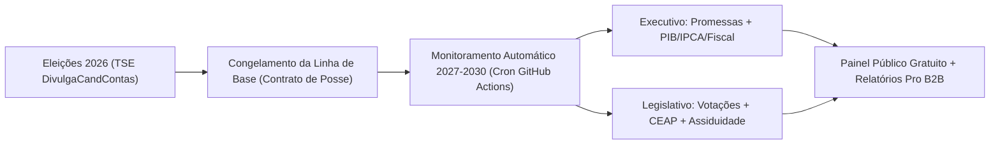

# Plano de Crescimento, Observatório de Mandatos (2027–2030) & Estratégia de Monetização

> **Propósito do Documento:** Consolidar a visão estratégica de evolução da plataforma **Voto Consciente** após o ciclo eleitoral de 2026, mapeando o mercado brasileiro de *Civic Tech*, a arquitetura do **Observatório Permanente do Mandato (2027–2030)**, as garantias de **blindagem jurídica via Open Source** e os **modelos éticos de monetização (B2C e B2B)**.

---

## 1. Panorama do Mercado Brasileiro (Análise Competitiva)

Atualmente, o ecossistema brasileiro de fiscalização política e transparência pública é **fragmentado**. Não existe nenhuma plataforma aberta que una, em um único painel interativo e automatizado, o plano de governo registrado no TSE, o acompanhamento contínuo do Executivo e do Legislativo e a evolução dos indicadores macroeconômicos oficiais.

| Iniciativa Atual | Foco de Atuação | Limitações Atuais | Diferencial do **Voto Consciente** |
| :--- | :--- | :--- | :--- |
| **Promessas dos Políticos (G1 / Globo)** | Executivo (Presidente, Governadores e Prefeitos de capitais). | Atualização manual apenas **1 vez por ano** (aniversário de posse); não cruza promessas com indicadores econômicos (PIB, IPCA, Dívida/PIB); **não cobre Senadores nem Deputados**. | Painel contínuo com cruzamento direto entre promessas do TSE, indicadores do IBGE/Bacen e cobertura de Executivo + Legislativo nas 27 UFs. |
| **Ranking dos Políticos (`politicos.org.br`)** | Legislativo Federal (Deputados Federais e Senadores). | **Não acompanha o Presidente nem os Governadores estaduais**; não audita planos de governo registrados no TSE; pesos da nota são fixos pela organização. | Cobre Executivo e Legislativo; permite que o próprio cidadão **personalize os pesos do Score (0–100)** em tempo real (`WeightCustomizerModal.vue`). |
| **Agências de Checagem (Lupa / Aos Fatos / Comprova)** | Fact-checking de declarações e discursos isolados. | Funcionam como portais de notícias avulsas; não possuem painel estruturado de metas de mandato, orçamento ou evolução de indicadores. | Integra as checagens certificadas pela IFCN diretamente dentro do dossiê permanente de cada mandatário (`FactCheckTimeline.vue`). |
| **Portais Oficiais (TSE, Tesouro, Câmara, Senado, IBGE)** | Dados brutos governamentais e APIs públicas. | Interfaces técnicas e fragmentadas; não conectam **o que foi prometido na campanha** com **o que foi executado no mandato**. | Unifica e traduz os dados oficiais das APIs públicas em visualizações claras e auditáveis com *deep links* para o documento primário. |

---

## 2. Evolução do Produto: Observatório Permanente do Mandato (2027–2030)

Enquanto 99% dos sites eleitorais perdem utilidade após o 2º turno, o **Voto Consciente** já possui a base tecnológica pronta (`CurrentMandateView.vue`, `ElectedCandidatesView.vue`, `elected-2026.json` e `scrape-news.ts`) para se converter no **Observatório Permanente dos Eleitos (2027–2030 / 2035)**.

### 2.1. Pilar 1 — "Contrato de Posse" (Congelamento das Promessas Registradas no TSE)
- Assim que o pleito é encerrado, o Plano de Governo protocolado no TSE pelo **Presidente eleito**, pelos **27 Governadores eleitos** e os compromissos dos **54 Senadores eleitos** (já mapeados em `src/data/elected-2026.json`) tornam-se um **Catálogo Imutável de Metas Auditáveis**.
- Cada compromisso é acompanhado por status objetivos:
  - `Cumprida (Com Lei / Decreto / Entrega Oficial)`
  - `Em Andamento (Em Tramitação / Execução Orçamentária)`
  - `Atrasada / Parcialmente Cumprida`
  - `Não Cumprida / Descartada`
- **Regra de Auditoria:** Nenhuma promessa muda de status sem o vínculo obrigatório (`sourceUrl`) ao ato oficial (Diário Oficial da União/Estado, Projeto de Lei sancionado ou relatório do Tesouro/IBGE).

### 2.2. Pilar 2 — Automação 100% Oficial via APIs Governamentais (Sem Custo de Servidor)
Expansão do workflow `.github/workflows/update-news.yml` e do serviço `src/services/publicDataApis.ts` para consumir periodicamente as APIs abertas e gratuitas do Estado brasileiro:

1. **API SGS do Banco Central (`api.bcb.gov.br`) & API SIDRA do IBGE (`apisidra.ibge.gov.br`):**
   - Atualização automática mensal no `EconomicTrendChart.vue` de:
     - **IPCA acumulado 12 meses** (Série SGS 13522 / IBGE);
     - **Taxa Selic Meta** (Série SGS 432);
     - **Crescimento do PIB trimestral e anual** (Contas Nacionais IBGE);
     - **Taxa de Desocupação / Desemprego** (PNAD Contínua IBGE);
     - **Dívida Bruta do Governo Geral (% do PIB)** e **Resultado Primário** (Tesouro Transparente / Bacen).
   - Comparação visual imediata: *"Indicador no Dia da Posse (01/01/2027) vs. Indicador Atual"*.
2. **API de Dados Abertos da Câmara (`dadosabertos.camara.leg.br`) e do Senado (`legis.senado.leg.br/dadosabertos`):**
   - Coleta automática de projetos apresentados, relatorias, presença em plenário, gastos da Cota Parlamentar (CEAP/CEAPS) e **votações nominais** em PECs e Projetos de Lei estruturantes.
3. **Monitoramento do Diário Oficial (DOU) e Agências Públicas (`scrape-news.ts`):**
   - Coleta contínua na **Agência Brasil (EBC)**, **Agência Senado**, **Agência Câmara** e **TV Justiça/STF/TCU** vinculando sanções, vetos e decretos aos dossiês dos eleitos.

### 2.3. Pilar 3 — Marcos de Mandato & Coerência "Promessa vs. Voto"
- **Balanço de 100 Dias, 1º Ano, Meio de Mandato (2 Anos) e Fim de Mandato (4 Anos):** Relatórios comparativos automáticos da evolução do mandato presidencial e dos governos estaduais.
- **Índice de Coerência Parlamentar (Promessa vs. Voto Real):** Cruza as bandeiras que o Senador ou Deputado defendeu na campanha de 2026 com a forma como ele efetivamente votou no plenário do Congresso Nacional.

---

## 3. Blindagem Jurídica e Por Que Manter o Projeto Open Source

Um receio natural ao publicar uma plataforma de transparência política no Brasil é o risco de questionamentos judiciais ou acusações de parcialidade. Manter o projeto **Open Source, apartidário e estritamente ancorado em dados públicos oficiais** é justamente a maior camada de proteção jurídica e reputacional possível:

### 3.1. Defesa contra Acusações de Manipulação ("Caixa-Preta")
- Plataformas de código fechado sofrem ataques constantes de militâncias políticas sob a alegação de que o algoritmo "favorece o candidato A ou B".
- Com o código aberto no GitHub (`src/services/scoringEngine.ts` e `src/services/sourceValidator.ts`), qualquer cidadão, jornalista, partido político ou auditor do Ministério Público pode verificar que **as regras matemáticas são idênticas para todos** e que **o próprio usuário pode alterar os pesos** na interface (`WeightCustomizerModal.vue`).

### 3.2. Respaldo Constitucional e Legal Sólido
Conforme detalhado em [`doc/COMPLIANCE_E_AVISO_LEGAL.md`](./COMPLIANCE_E_AVISO_LEGAL.md):
- **Lei de Acesso à Informação (Lei Federal nº 12.527/2011):** Dados produzidos ou custodiados por órgãos públicos (TSE, Câmara, Senado, STF, TCU, IBGE, Banco Central) são patrimônio público de livre acesso, indexação e divulgação.
- **Constituição Federal (Art. 5º, IV, IX, XIV, XXXIII e Art. 220) e STF (ADI 4451):** O Supremo Tribunal Federal pacificou a proteção plena a plataformas e veículos que realizam análise crítica, acompanhamento de metas e divulgação de fatos públicos sobre candidatos e governantes.
- **Princípio do *Animus Narrandi*:** O sistema nunca emite xingamentos, adjetivações ofensivas ou juízos morais; limita-se a exibir dados objetivos com link direto (*deep link*) para a certidão, acórdão ou fonte oficial.

### 3.3. Camadas Adicionais Recomendadas Antes do Lançamento Público Amplo
1. **Botão "Solicitar Retificação / Direito de Atualização com Fonte Oficial":**
   - Formulário simples (ou template de Issue no GitHub) onde qualquer assessoria jurídica ou cidadão pode enviar uma certidão atualizada do TSE/STF/TCU ou link do Diário Oficial para atualização imediata. Isso demonstra boa-fé objetiva (*compliance* com o Marco Civil da Internet — Lei nº 12.965/2014).
2. **Termos de Uso e Isenção de Responsabilidade Explícitos no Rodapé (`DisclaimerModal.vue`):**
   - Deixar explícito que os dados refletem as bases governamentais consultadas na data da verificação (`verifiedAt`) e que o link oficial da fonte primária sempre prevalece.

---

## 4. Estratégia de Monetização Ética e Sustentável

### ⚠️ Regra de Ouro da Monetização Cívica
> **Jamais cobrar de políticos, candidatos, partidos ou governos** para alterar notas, destacar perfis ou patrocinar conteúdos. A credibilidade e a independência apartidária são o maior ativo financeiro da plataforma.

Abaixo estão os **4 modelos reais de receita** validados por plataformas de *Civic Tech* e inteligência política no Brasil (*Ranking dos Políticos*, *Operação Serenata de Amor*, *JOTA*, *Poder360*, *Nexo*):

### Modelo 1: Apoio Cidadão Recorrente (B2C Crowdfunding — Curto Prazo)
- **Canais:** Pix Institucional, Apoia.se, Catarse Assinaturas e **GitHub Sponsors**.
- **Proposta de Valor:** *"Mantenha a auditoria independente dos políticos 100% livre de dinheiro público ou partidário"*.
- **Faixas de Apoio:** R$ 10/mês, R$ 25/mês ou R$ 50/mês, oferecendo transparência pública dos custos de infraestrutura e nome no mural de apoiadores da transparência.

### Modelo 2: Plano "Pro / Inteligência Legislativa & Governamental" (SaaS B2B — Maior Potencial de Receita)
A plataforma web permanece **100% gratuita e aberta para o eleitor comum**, mas oferece recursos profissionais por assinatura (**R$ 49 a R$ 199/mês**) voltados para **jornalistas, cientistas políticos, assessorias parlamentares, escritórios de advocacia, relações governamentais (RIG), sindicatos e analistas do mercado financeiro**:
- **Alertas Automáticos Segmentados (WhatsApp / Telegram / E-mail):** Notificação imediata quando uma promessa de determinada área (ex: Reforma Tributária, Agronegócio, Saúde, Educação, Segurança) muda de status, quando sai ato no Diário Oficial ou quando um Senador/Deputado movimenta projeto no Congresso.
- **Exportação de Dossiês Executivos (PDF / CSV / Excel):** Geração com 1 clique de relatórios analíticos prontos para impressão ou apresentação, contendo gráficos comparativos (`RadarChart`, `EconomicTrendChart`, `PromisesProgress`) e histórico completo de fontes.
- **API de Dados Cruzados:** Acesso via token para desenvolvedores e redações consumirem a base já higienizada e unificada (TSE + Câmara + Senado + IBGE + Bacen).

### Modelo 3: Newsletter Semanal Automatizada ("Boletim da Auditoria da Semana")
- Aproveita o próprio pipeline automatizado (`scripts/scrape-news.ts` + indicadores econômicos) para disparar toda sexta-feira um resumo executivo de 3 minutos:
  - *"O que o Governo cumpriu ou atrasou nesta semana"*;
  - *"Como os Senadores e Deputados do seu estado votaram"*;
  - *"Atualização dos indicadores oficiais (IPCA, Selic, PIB, Emprego)"*.
- **Monetização:** Patrocínio corporativo direto no cabeçalho da newsletter (corretoras de investimentos, fintechs, editoras, pós-graduações em gestão pública/direito/economia — nicho com um dos maiores CPMs do mercado brasileiro).

### Modelo 4: Editais e Grants de Transparência Pública e Jornalismo de Dados (Fundo Perdido)
- Por ser **Open Source**, apartidário e fundamentado em dados abertos governamentais, o projeto é elegível para financiamento não-reembolsável (*grants*) de instituições nacionais e internacionais:
  - **Google News Initiative (GNI Innovation Challenge)**;
  - **Open Knowledge Brasil (OKBR)**;
  - **Editais de Inovação Cívica, Controle Social e Dados Abertos**.

---

## 5. Cronograma Sugerido de Implementação (Próximas Fases)

| Fase | Escopo Técnico | Entregáveis Principais |
| :---: | :--- | :--- |
| **Fase 1 (Pós-2º Turno)** | **Modo Transição & Contrato de Posse 2027** | Congelamento das promessas do Presidente eleito e dos 27 Governadores eleitos como metas auditáveis (`2027–2030`). |
| **Fase 2 (Automação APIs)** | **Integração Automática Bacen + IBGE + Congresso** | Script no GitHub Actions buscando mensalmente IPCA, Selic, PIB e Desemprego na API SGS/SIDRA e votações/assiduidade nas APIs da Câmara e do Senado. |
| **Fase 3 (Comunidade & Retificação)** | **Canal Oficial de Retificação & Apoio Cidadão** | Modal de solicitação de atualização documental com fonte oficial + botão de Apoio Independente / Newsletter. |
| **Fase 4 (B2B / Pro)** | **Exportação de Dossiês PDF & Alertas Temáticos** | Gerador de relatórios executivos em PDF e sistema de alertas por eixo temático (Economia, Segurança, Saúde, Educação, Tributário). |
